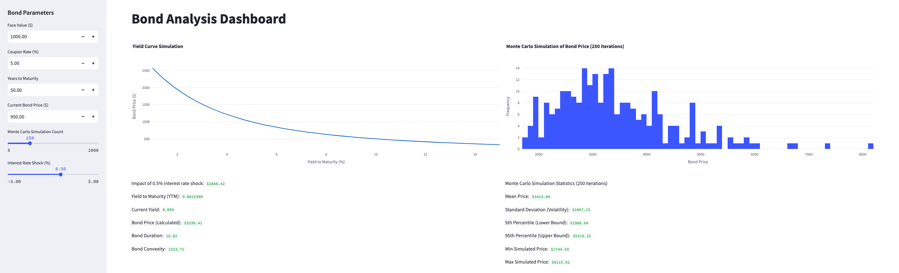

# Fixed-Income Bond Analysis Dashboard

An interactive **Streamlit** dashboard for bond valuation, interest-rate risk, and Monte Carlo price simulation, built with Python, NumPy, SciPy, and Plotly.



## Features

- **Yield to Maturity (YTM)**: solved numerically (Brent's method) from the market price.
- **Bond pricing**: present value of the coupon and principal cash flows at a given YTM.
- **Macaulay & modified duration, convexity**: interest-rate sensitivity and curvature.
- **Current yield**: annual coupon divided by market price.
- **Rate shock scenario**: exact repricing under a parallel yield shift, next to a duration + convexity estimate as a sanity check.
- **Monte Carlo simulation**: bond price distribution from normally distributed yields (configurable volatility and seed), with mean, standard deviation, 5th/95th percentiles, min and max.

## Conventions

Coupon rate and yields are annual rates; YTM is compounded at the coupon frequency (semiannual by default, i.e. bond-equivalent yield). Durations are in years and convexity in years². Pricing, YTM, duration, convexity, and the simulation all use the same conventions, so repricing at the solved YTM returns the market price.

## Run locally

```bash
python -m venv .venv && source .venv/bin/activate   # Windows: .venv\Scripts\activate
pip install -r requirements.txt
streamlit run bond-analysis-dashboard.py
```

## Tests

```bash
pip install -r requirements-dev.txt
pytest
```

The tests cover price/YTM round-trips across coupon frequencies, closed-form duration values, duration and convexity against finite differences, edge cases (zero coupon, zero yield, unsolvable prices), and Monte Carlo reproducibility.

## Project layout

| File | Purpose |
| --- | --- |
| `bond-analysis-dashboard.py` | Streamlit app (UI only) |
| `bond_math.py` | Bond math, no Streamlit dependency |
| `tests/` | Unit tests for `bond_math.py` |
| `bond-analysis.py` | Standalone walkthrough script (exported notebook); needs `requirements-dev.txt` for matplotlib |

## License

MIT, see [LICENSE](LICENSE).
